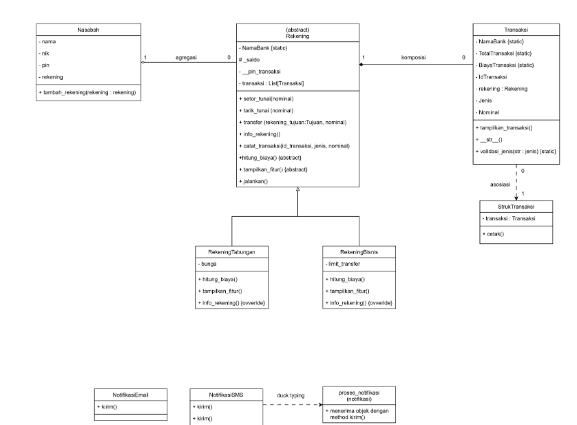
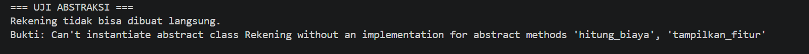
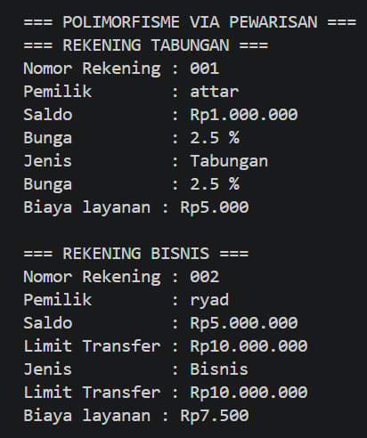
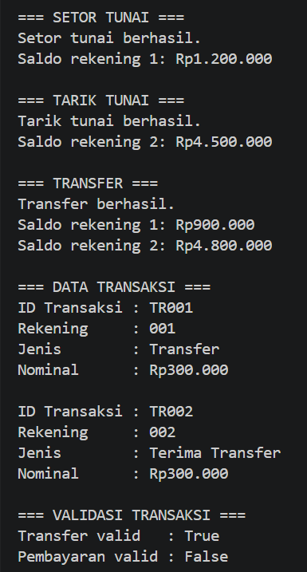
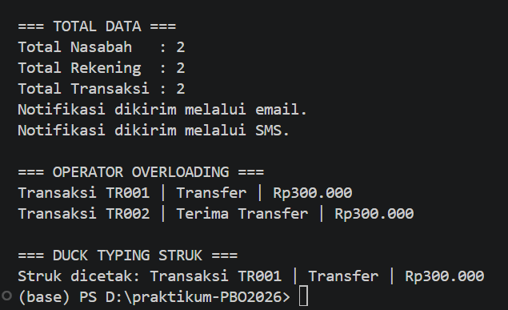

# Sistem Perbankan Sederhana

Simulasi dari perbankan sederhana dengan menerapkan konsep pemrograman berbasi objek.

## Class Diagram

### Penjelasan Relasi

- **Asosiasi — `Rekening` dan `Nasabah`:** Kelas `Rekening` menyimpan referensi objek nasabah melalui atribut `self.nasabah`. Referensi ini digunakan, misalnya, ketika `info_rekening()` menampilkan nama pemilik rekening.
- **Agregasi — `Nasabah` dan `Rekening`:** Kelas `Nasabah` menyimpan daftar objek rekening pada atribut `self.rekening` melalui `tambah_rekening()`. Objek rekening dibuat secara terpisah dan tidak dibuat atau dihapus otomatis oleh objek nasabah.
- **Komposisi — `Rekening` dan `Transaksi`:** Method `catat_transaksi()` pada `Rekening` membuat objek `Transaksi` dan menyimpannya dalam `self.transaksi`. Ini menunjukkan pola kepemilikan transaksi oleh rekening dalam program. Catatan: karena method mengembalikan objek transaksi dan Python memungkinkan referensi lain menyimpannya, kode ini tidak memaksakan penghancuran siklus hidup transaksi ketika rekening tidak lagi digunakan.

## Abstraksi

Kelas `Rekening` merupakan abstract class yang menggunakan `ABC` dan memiliki dua abstract method, yaitu `hitung_biaya()` dan `tampilkan_fitur()`. Kedua method tersebut diimplementasikan oleh `RekeningTabungan` dan `RekeningBisnis`.

Kelas `Rekening` juga menyediakan method konkret `jalankan()` yang dapat digunakan bersama oleh kedua subclass. Bukti bahwa abstract class tidak dapat diinstansiasi ditampilkan melalui blok `try-except TypeError` pada program utama.

## Polimorfisme

### Polimorfisme melalui Pewarisan

Kelas `RekeningTabungan` dan `RekeningBisnis` sama-sama melakukan override terhadap method `info_rekening()` dengan tampilan informasi yang berbeda. Objek dari kedua subclass kemudian diproses dalam satu perulangan melalui method `jalankan()`.

### Duck Typing

Kelas `NotifikasiEmail` dan `NotifikasiSMS` tidak saling mewarisi, tetapi keduanya memiliki method `kirim()`. Kedua objek dipanggil melalui fungsi yang sama, yaitu `proses_notifikasi()`.

### Operator Overloading

Kelas `Transaksi` mengimplementasikan magic method `__str__()`. Dengan demikian, objek transaksi dapat langsung ditampilkan menggunakan `print(transaksi)` dalam format yang ditentukan oleh kelas tersebut.

## Screenshot Output Program

### 1. Bukti Abstract Class Tidak Bisa Diinstansiasi

Class Rekening tidak dapat dibuat menjadi objek secara langsung karena memiliki abstract method yang harus diimplementasikan oleh subclass.

### 2. Polimorfisme melalui Pewarisan

Rekening tabungan dan rekening bisnis menggunakan method yang sama, tetapi menampilkan informasi dan biaya layanan yang berbeda sesuai jenis rekeningnya.

### 3. Transaksi dan validasi

Program menyediakan fitur setor tunai, tarik tunai, dan transfer. Validasi digunakan untuk memastikan jenis transaksi sesuai dengan daftar yang diperbolehkan.

### 4. Duck Typing dan Operator Overloading

Duck typing ditunjukkan melalui pemanggilan method yang sama pada objek berbeda. Operator overloading menggunakan __str__() agar objek transaksi dapat ditampilkan dengan format yang lebih mudah dibaca.

